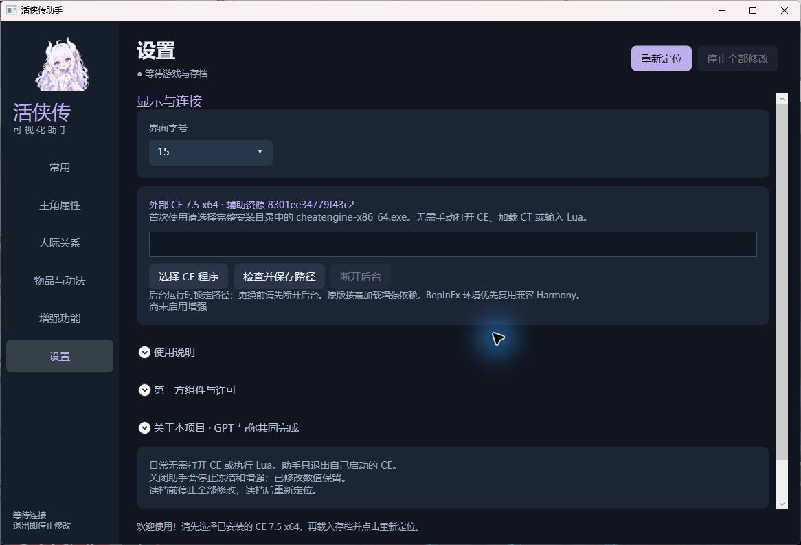
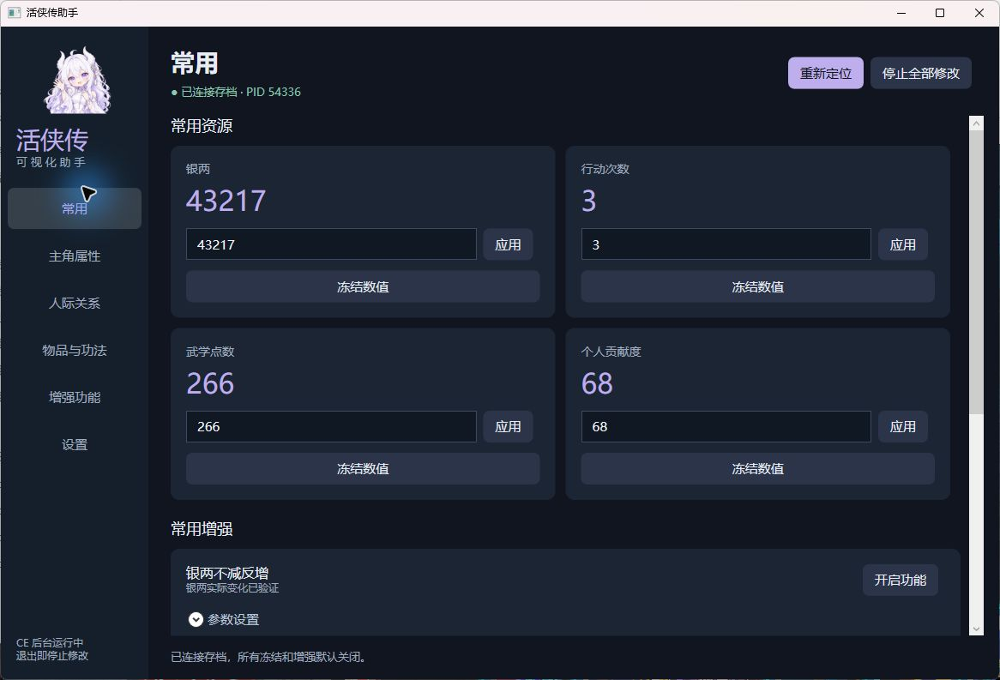

# 活侠传助手

<p align="center"></p>
<p align="center">中文可视化界面 · 外部 CE 7.5 x64 · 原版 / BepInEx</p>

**本项目免费、非盈利，源码公开，允许遵守许可证的非商业使用、学习、修改和分享。**

自有代码采用 [PolyForm Noncommercial 1.0.0](LICENSE)，请保留许可与版权声明。这是一份非商业源码许可，不属于 OSI 定义的开源许可。第三方组件继续按各自许可证授权，详见 [第三方声明](third-party/NOTICE.zh-CN.txt)。

## 下载哪个文件

- **普通使用：**从 [最新发行版本](https://github.com/kanonly/LegendOfMortal-Assistant/releases/latest) 下载运行版 ZIP，完整解压后打开 **活侠传助手.exe**。**不需要下载源码，也不需要编译。** CE 7.5 x64 仍需自行完整安装。
- **开发修改：**从 [项目仓库](https://github.com/kanonly/LegendOfMortal-Assistant) 获取源码，按下方“源码与构建”操作。GitHub 自动生成的 `Source code` 压缩包是源码，不是可直接运行的发行包。

运行版下载请进入 Releases；仓库中的源码不影响运行版的独立使用。

## 第一次使用

运行环境：Windows x64、.NET Framework 4.8、**完整 CE 7.5 x64**。当前适配《活侠传》`release_1.0.6000.2`（Unity Mono）；其他游戏版本尚未确认。

1. 自行从 [Cheat Engine 官方网站](https://www.cheatengine.org/) 获取并安装 CE。助手目前验证的是 **7.5 x64**；官网默认下载版本可能更新，请核对所装版本。本项目不包含、下载或安装 CE。
2. 将发行 ZIP 完整解压到可写目录，双击 **活侠传助手.exe**。
3. 首次启动进入“设置”，选择 CE 安装目录中的 **cheatengine-x86_64.exe**，点击 **“检查并保存路径”**。请保留 CE 的整个安装目录，不能只复制这一个 exe。
4. 启动游戏，等待至少 30 秒并进入存档；点击顶部 **“重新定位”**。显示“已连接存档”后即可操作，所有冻结与增强默认关闭。

以后只需打开游戏和助手。助手会自动启动自己使用的隐藏 CE，无需手动加载 CT 或输入 Lua；不会接管你手动打开的 CE。



## 怎么操作



| 页面 | 操作 |
|---|---|
| 常用 | 修改银两、行动次数、武学点数与贡献度；使用常用增强开关 |
| 主角属性 | 按四组浏览 54 项属性，编辑基础值，查看范围及手动刷新最终值 |
| 人际关系 | 搜索人物，选中后在右侧修改好感与已结识／显示标记 |
| 物品与功法 | 分类 → 搜索名称或 ID → 选中条目 → 详情编辑；默认“仅已拥有”，可取消筛选 |
| 增强功能 | 按养成、属性变化、好感、战役、决斗、轮盘分类；需要时展开参数 |
| 设置 | 调整字号、配置外部 CE、查看说明、依赖状态及开发署名 |

- **改值：**输入整数后点击“应用”。大号数字是当前值，输入框是待提交值；自动刷新不会覆盖输入草稿。
- **冻结：**点击“冻结数值”，后台确认后显示“已冻结 · 解除”；再次点击解除。
- **不减反增：**处理游戏通过对应函数发生的数值增减，与冻结不同。增强开关只有后台确认后才显示开启。
- **功法等级／修炼点数：**选中功法后，在右侧详情展开；直接改等级不会追补原本升级时发放的奖励。
- **基础值与最终值：**最终值包含装备等加成，需要点击“刷新最终值”。轻功等仍受原有上限限制，到 100 后加基础值可能仍显示 100。

直接改值后，部分游戏界面需要切换页面或重新打开才能刷新。

## 读档、停止与退出

- 读档前点 **“停止全部修改”**；载入后点 **“重新定位”**。游戏重启后也要重新定位，不会恢复旧冻结或增强。
- 正常关闭助手会先解除本程序冻结、撤销本程序补丁，再退出它启动的 CE。
- **已经修改的数值会保留**，需要撤销时手动改回或重新读档。助手不主动保存游戏，游戏自身的自动保存仍按原逻辑运行。
- 更换 CE 路径前，在设置点 **“断开后台”**，等待清理完成后再选择和保存新路径。
- 原版游戏按需加载助手提供的增强依赖；BepInEx 环境优先复用兼容的已加载 Harmony。不向游戏安装 BepInEx，也不覆盖原游戏 DLL 或插件。

## 常见问题

**提示 CE 文件缺失：**使用完整 CE 7.5 x64 安装目录，需包含 `lua53-64.dll`、`main.lua`、`defines.lua`、`autorun/monoscript.lua`、`autorun/dlls/MonoDataCollector64.dll` 和对应表单。缺少哪项会直接提示。

**等待游戏或无法定位：**确认打开的是 `Mortal.exe`、已经进入存档并完成加载，再重新定位。不要同时启用旧 CT 或其他版本助手。

**连接中断：**助手暂停提交写入。按提示重新定位；若提示增强撤销未确认，请重启游戏，不能把断线视为已经清理。

**设置存在哪里：**exe 同目录的“助手数据”，只保存界面偏好、CE 路径与辅助资源缓存，不保存作弊开启状态。分享时不要携带此目录。

## 验证范围

本次版本的实际验证记录见 [发布验证](docs/validation.md)。历史原版与 BepInEx 测试和本次测试分别列出，不把旧版结果算成本次实测。

战役、决斗、实际轮盘、完整炼丹／修炼流程，以及时间变化对剧情的影响仍待对应场景验证。补丁安装成功不代表实战效果已验证。

## 源码与构建

使用 Windows、PowerShell 7 和系统的 .NET Framework 4.x C# 编译器，不需要安装 .NET SDK。仓库中的 `third-party/managed` 提供已列明许可的增强依赖。

```powershell
# 直接构建界面，使用仓库现有 CT
pwsh -File .\tools\build-frontend.ps1

# 修改共享运行时后，先通过你自己的游戏目录重新生成 CT
pwsh -File .\tools\build.ps1 -GameDir '你的游戏目录'
pwsh -File .\tools\build-frontend.ps1

# 语法与结构检查；CE 仅作为本地验证工具，不复制进产物
pwsh -File .\tests\validate-frontend.ps1 -CheatEngineDir '你的 CE 安装目录'
pwsh -File .\tests\validate-release.ps1

# 生成发行 ZIP 与干净 GitHub 目录
pwsh -File .\tools\package-release.ps1
```

构建时需要的游戏程序集只从你指定的目录读取，不复制到仓库或发行包。可通过 `-DependencyDir` 指定其他兼容的增强依赖目录。

## 开发与角色说明

**本项目主要逆向分析、代码实现、界面开发及文档编写由 GPT 辅助完成；项目发起者负责需求、方向决策、角色参考提供及游戏内操作与测试配合。**

**GPT娘角色来源：ZipZipPipe**

角色图由 OpenAI imagegen 参考用户提供的角色设计生成，用作本项目的 GPT 助手拟人形象。参考原图和三视图不随项目提供。素材生成说明见 [美术说明](assets/ARTWORK.md)。

本项目不提供游戏本体、游戏程序集或 CE。发布目录与发行包均不包含个人配置、游戏存档或旧内嵌 CE 版。
